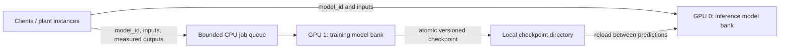

# Adaptive small neural networks on two GPUs

A minimal continuation of an October–November 2024 study: keep 100–200 small
neural-network instances available on one RTX 3060 while another RTX 3060 learns
from newly arriving labelled data. The original study also explores MPS, parallel
CUDA processes, matrix operations, and CUDA streams.

**Status:** research prototype. Two-RTX-3060 throughput, memory capacity, and live
adaptation performance have **not been verified**. See [validation](docs/VALIDATION.md).

## What is included

| Path | Purpose |
| --- | --- |
| `study-scripts/` | Relevant original neural-network, MPS, MPI, matrix, and FFT source files, copied unchanged |
| `adaptive_mgpu/model.py` | Original 10 → 128 → 128 → 10 ReLU MIMO network |
| `adaptive_mgpu/server.py` | Inference model bank, labelled-data API, explicit GPU selection, spawned trainer lifecycle |
| `adaptive_mgpu/trainer.py` | Independent Adam optimizers, bounded replay, atomic per-model publication and restart |
| `adaptive_mgpu/demo.py` | Original nonlinear MIMO target, held-out drift experiment, HTTP load generator |
| `scripts/with_mps.sh` | Optional Linux MPS initialization and client thread ceiling |
| `docs/STUDY_REVIEW.md` | Detailed inspection, missing connections, and minimum success criteria |
| `tests/`, `.github/workflows/` | CPU integration checks and GitHub Actions configuration |

The external original files were not edited. `docs/original-sha256.json` records
their source hashes, including unrelated experiments omitted from this folder.
No compiled binaries or checkpoints are included.

## Execution design



The default bank permits IDs `0..199`. Each ID has **independent weights and an
independent optimizer**. Models are created lazily. Requests for one ID can carry
multiple rows; requests for different IDs are serialized by one inference owner.
This is logical concurrency, not 200 Python CUDA processes or a guarantee of 200
simultaneous kernels. For multiple clients learning the same plant, use the same
ID and batch their inputs. Different plants should use different IDs.

Training and inference overlap in separate processes. Each model's training jobs
run sequentially on the training GPU. A newly published checkpoint is loaded at
the next prediction; loading briefly occupies the inference lock. This simple
filesystem handoff trades some latency for small implementation scope. Both
processes must run on the same host with a local checkpoint directory.

## Install

Use Linux and Python 3.11. Create a virtual environment **inside this folder**:

```bash
python3 -m venv .venv
source .venv/bin/activate
python -m pip install --upgrade pip
```

For the RTX machines, install a CUDA-enabled PyTorch wheel using the command from
the [official selector](https://pytorch.org/get-started/locally/) appropriate to
the installed driver. Then install the small application dependencies:

```bash
python -m pip install -r requirements.txt
nvidia-smi
python -c 'import torch; print(torch.__version__, torch.cuda.is_available(), torch.cuda.device_count())'
```

Expect two CUDA devices. Start the prototype:

```bash
python -m adaptive_mgpu.server --infer-device cuda:0 --train-device cuda:1 --instances 200
```

`CUDA_VISIBLE_DEVICES` changes logical numbering. For example, if physical GPUs
`2,3` are exposed in that order, this server still uses logical `cuda:0,cuda:1`.
The server fails on an unavailable GPU rather than silently falling back to CPU.
Use one server per checkpoint directory; do not launch multiple training writers
or multiple WSGI worker processes against the same directory.

For a future CPU-only smoke check, explicitly pass
`--infer-device cpu --train-device cpu --instances 2`. This checks plumbing, not
dual-GPU behavior or capacity. No further tests were run after the owner's request.

## Initial learning and new measurements

All vectors contain exactly 10 finite values. Requests default to `model_id: 0`.

| Endpoint | Payload | Result |
| --- | --- | --- |
| `POST /train` | `model_id`, `inputs: [[...]]`, `outputs: [[...]]` | Queues initial training, returns HTTP 202 |
| `POST /predict` | `model_id`, `input: [...]` or `inputs: [[...]]` | Prediction(s) and served model version |
| `POST /observe` | `model_id`, `inputs: [[...]]`, `outputs: [[...]]` | Queues adaptation, returns HTTP 202 |
| `GET /health` | None | Trainer process liveness, configured devices, versions already loaded for inference |

Example pure inference after initial training:

```bash
curl --fail http://127.0.0.1:5000/predict \
  -H 'Content-Type: application/json' \
  -d '{"model_id":0,"input":[0,0,0,0,0,0,0,0,0,0]}'
```

The original single-sample `actual_output` field is also supported on `/predict`.
For delayed labels, keep the corresponding original input and send the pair to
`/observe` when the actual output becomes available. Pure predictions need no
labels and do not train the model. A supervised model cannot adapt to plant
changes from unlabelled inputs alone.

`/train` uses `--initial-steps` (default 500) Adam steps; `/observe` uses
`--update-steps` (default 10). These are optimizer steps, not epochs. `/train` on
an existing ID continues learning rather than resetting it. Before the first
published checkpoint, `/predict` returns 503. Repeated polling returns a version
once ready. `loaded_versions` in health is not a training-completion ledger.

The queue holds at most 256 jobs, and each labelled request accepts at most 2,048
rows by default. Submit new labels in batches to avoid training and publishing
once for every scalar request. A full queue or dead trainer returns 503 for
labelled requests; retain those labels and retry with backoff. Pure inference can
continue from the last checkpoint if training stops. A 202 acknowledges a queued
job, not completed or durable training. Stop/restart can lose queued jobs and
unpublished work; replay is bounded in memory and is not restored. Weights, Adam
state, and version are restored from the latest complete checkpoint. Retry is
not deduplicated. The current `/health` liveness check cannot detect a hung worker.

## MPS and maximum GPU thread use

The original MPS and stream experiments are included; see the
[script map and review](docs/STUDY_REVIEW.md). The minimal bank uses one CUDA
context per process/device and does not require MPS. MPS is an optional comparison
for the original multi-process approach, not a requirement for two GPUs.

On the actual Linux NVIDIA machine, initialize MPS and launch a command with both
GPUs visible:

```bash
bash scripts/with_mps.sh 0,1 python -m adaptive_mgpu.server --instances 200
```

The wrapper resolves physical GPU indices to UUIDs, creates private control/log
directories in `/tmp`, and defaults to `CUDA_MPS_ACTIVE_THREAD_PERCENTAGE=100`.
For a manual capped-client experiment:

```bash
MPS_THREAD_PERCENTAGE=25 bash scripts/with_mps.sh 0,1 python -m adaptive_mgpu.server --instances 200
```

This caps each client's available execution resources; it is not a reservation,
does not create more threads, and does not guarantee fair scheduling or speedup.
Do not automatically divide 100 by the number of models. The 100% default permits
maximum availability; actual occupancy depends on workload and kernel shapes.
The included legacy scripts require the corrections listed in the review before
their results can be trusted. The wrapper has not been run or hardware-validated.
It changes neither compute mode nor driver settings. Stop its daemon after all
its clients have exited:

```bash
bash scripts/with_mps.sh --stop
```

NVIDIA documents a finite number of MPS client CUDA contexts per device, dependent
on software generation. Consequently 100–200 logical instances should not be
equated with 100–200 MPS clients. See the
[official MPS guide](https://docs.nvidia.com/deploy/pdf/CUDA_Multi_Process_Service_Overview.pdf).

## Experiment and acceptance

The finite demo initializes each requested model, applies a fixed synthetic plant
change, and compares frozen-model and adapted-model error on a separate holdout:

```bash
python -m adaptive_mgpu.demo --instances 1 --updates 30
```

On the GPU machine, increase gradually to 100 and 200 IDs. Initialization and
adaptation are intentionally sequential in the demo so each result is attributable.
After all IDs are initialized, measure concurrent HTTP inference:

```bash
python -m adaptive_mgpu.demo --skip-training --instances 200 --clients 200 --load-requests 10000
```

To assess overlap, repeat that load command while a separate demo or your plant
client feeds labelled batches to the same IDs. Re-running the demo continues
existing models and therefore is not an independent experiment; use a fresh
`--checkpoints` directory for independent runs. The load generator reports HTTP
p50/p95, successful requests/second, and failures. These include networking, JSON,
queueing, and checkpoint reload time; they are not GPU kernel timings.

Before calling the target achieved, record both GPUs' actual model/VRAM/driver,
PyTorch/CUDA versions, instance count, prediction rate, label rate, batch size,
training budget, adaptation delay, p95 latency, peak VRAM, and failed requests.
Define acceptable error and latency for the intended plant. There is no claimed
RTX 3060 performance result in this repository. A tiny MLP can be limited by
launch and HTTP overhead; compare batched CPU inference as well.

## GitHub preparation

Upload **this folder as the repository root**; the workflow assumes that layout.
It contains source, documentation, dependency ranges, ignore rules and a manual CPU workflow.
For a future validation run, install `requirements-dev.txt` and run
`python -m pytest -q`. The GitHub workflow runs only when manually requested;
publishing or pushing this repository does not start tests.

## License and citation

Copyright © 2024–2026 gedizgursu. This project uses the custom
[Noncommercial Attribution and Citation License 1.0](LICENSE).

You may use, study, modify, and share this work for noncommercial purposes under
that license. Retain the license and [attribution notice](NOTICE) when sharing
copies or modifications. Published research, public projects, and other public
work making material use of this project or its results must cite it. Commercial
use requires separate written permission from the copyright holder. This is
source-available software under a custom license, not an open-source license.
The full license controls; third-party dependencies retain their own licenses.

GitHub citation metadata is provided in [CITATION.cff](CITATION.cff). Suggested citation:

> gedizgursu. *Adaptive Small Neural Networks on Two GPUs*. Software and research
> study. Include the repository URL and version, commit, or access date used
> when available.

The Flask server is a loopback research harness with the debug reloader disabled.
Remote deployment and physical closed-loop control require additional work
described in the review.
